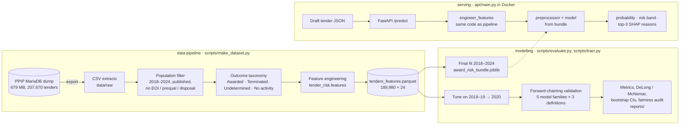
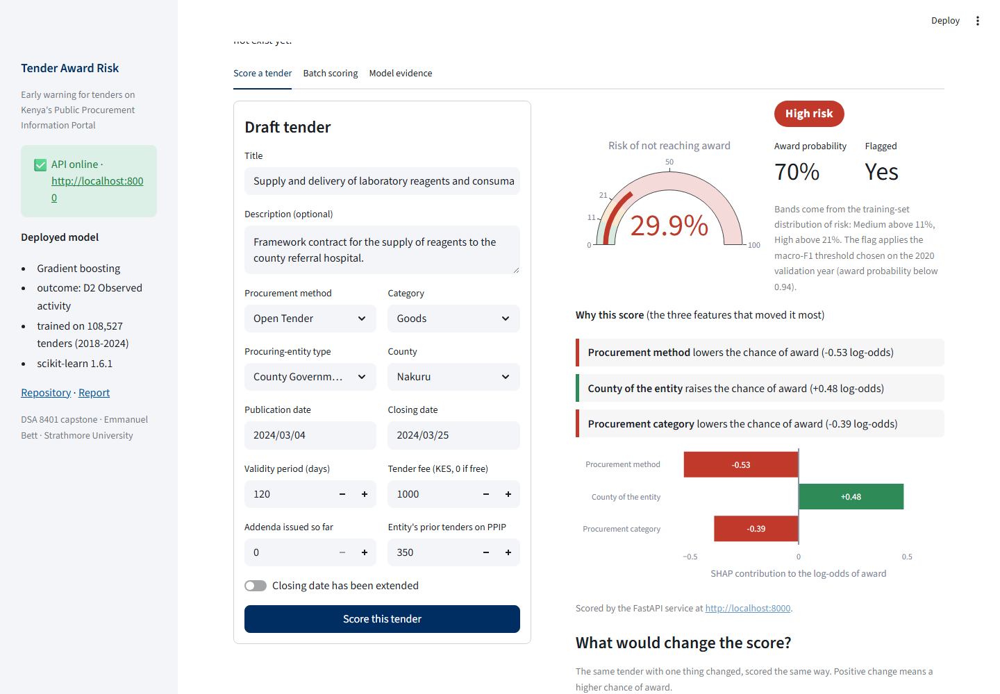

# Early-warning prediction of tender award failure in Kenyan public procurement

**DSA 8401 Applied Machine Learning capstone** · Emmanuel Bett (131611) · MSc Data Science and Analytics, Strathmore University

[](https://github.com/Emmanuelbett67/ppip-tender-award-risk/actions/workflows/ci.yml)

More than half of the tenders advertised on Kenya's Public Procurement Information Portal (PPIP) never reach a
recorded contract award. This project scores a tender **at publication**, using only information that exists by
its closing date, so a procuring entity can lengthen the bidding window, change the method or fix the
specification while the outcome can still change. The score is served by a FastAPI service in a Docker container
and audited for fairness across AGPO (youth, women and persons-with-disability) reservations and counties.

| | |
|---|---|
| Proposal | [`docs/proposal.pdf`](docs/proposal.pdf) |
| Final report | [`reports/REPORT.md`](reports/REPORT.md) · [PDF](reports/REPORT.pdf) |
| Research notebook (CRISP-DM record, executed) | [`notebooks/Tender_Award_Proposal_Aligned.ipynb`](notebooks/Tender_Award_Proposal_Aligned.ipynb) |
| AI-use disclosure | [`AI_USE.md`](AI_USE.md) |

## Headline results

Forward-chaining temporal validation (train 2018…Y−1, test Y, for Y = 2021–2024), primary outcome definition
"observed activity" (awarded vs terminated-or-stalled, 108,527 tenders):

| Model | Pooled ROC-AUC [95% CI] | F1 (non-award) |
|---|---|---|
| Logistic regression | 0.607 [0.602, 0.611] | 0.314 |
| Random forest | 0.622 [0.617, 0.627] | 0.323 |
| **Gradient boosting (deployed)** | **0.626 [0.621, 0.631]** | 0.309 |
| XGBoost | 0.620 [0.616, 0.625] | 0.305 |
| Stacked ensemble | 0.625 [0.620, 0.630] | 0.304 |

- The pilot in the proposal reported AUC 0.74 on a random split. The same XGBoost configuration evaluated
  honestly (forward-chaining) loses **0.15 AUC**: random splits leak the future.
- Performance depends strongly on how "failure" is labelled: AUC 0.73 (naive), 0.63 (observed activity),
  0.84 (documented terminations only). The ranking of the drivers is stable (Spearman ρ ≥ 0.87).
- Fairness: AGPO-reserved tenders are flagged *less* often (−2.9 pp, CI excludes 0) and calibration is equal
  (ECE difference −0.005, CI includes 0), but county disparities are large (flag rate 0.26–0.99).

Full tables, figures and interpretation are in [`reports/REPORT.md`](reports/REPORT.md).

## Architecture



The feature code in `src/tender_risk/features.py` is shared by the pipeline and the API, so a tender is
scored exactly as it would have been in training.

## Repository layout

```
├── api/main.py                 FastAPI service (/predict, /predict/batch, /model, /health)
├── app/streamlit_app.py        Streamlit demo UI (single tender, what-if, batch, evidence)
├── src/tender_risk/            installable package
│   ├── config.py               study-design constants (window, definitions, feature lists)
│   ├── features.py             feature engineering shared by pipeline and API
│   ├── data.py                 extracts → population → outcome classes → feature table
│   ├── preprocess.py           group-median imputer, one-hot, TF-IDF+SVD (fit inside each window)
│   ├── models.py               five model families, search spaces, threshold rule
│   ├── explain.py              TreeSHAP contributions grouped by source feature
│   └── scoring.py              load bundle, score raw tenders
├── scripts/
│   ├── make_dataset.py         stage 1: feature table
│   ├── evaluate.py             stage 2: forward-chaining validation, tests, fairness audit
│   ├── train.py                stage 3: final fit + serialized bundle
│   ├── predict.py              batch scoring CLI
│   └── make_sample.py          builds the committed 5% sample of the extracts
├── data/
│   ├── raw/                    full extracts (not committed, see below)
│   ├── sample/                 5% sample of the extracts, needed columns only (committed)
│   ├── processed/              feature tables (full table committed, 9.9 MB)
│   └── examples/               draft tenders for the batch CLI
├── models/award_risk_v2/       serialized bundle + metadata.json (committed)
├── reports/                    REPORT.md, metrics/*.csv, figures/*.png
├── notebooks/                  executed research notebook
├── tests/                      unit tests for features, the API and the UI
├── Dockerfile, docker-compose.yml, Makefile, .github/workflows/ci.yml
```

## Setup

Requirements: Python 3.11+ (3.13 used), or Docker.

```bash
git clone https://github.com/Emmanuelbett67/ppip-tender-award-risk.git
cd ppip-tender-award-risk
python -m venv .venv && source .venv/bin/activate      # Windows: .venv\Scripts\activate
pip install -e ".[dev]"
pytest -q                                               # unit tests + API tests against the committed bundle
```

## Demo UI



A Streamlit front-end (`app/streamlit_app.py`) lets a procurement officer enter a draft tender, see the award
probability, the risk band and the three SHAP reasons, and try changes (longer bidding window, open tender, no fee)
before the tender is advertised. It also scores CSV batches and shows the validation evidence. It calls the API
when the API is up and scores in-process from the committed bundle otherwise.

```bash
docker compose up --build        # API on :8000 and UI on http://localhost:8501
streamlit run app/streamlit_app.py   # without Docker (pip install -e .)
```

### Hosted on Streamlit Community Cloud

The UI deploys as is from this public repository: in <https://share.streamlit.io> choose *Create app*, repository
`Emmanuelbett67/ppip-tender-award-risk`, branch `main`, main file `app/streamlit_app.py`, Python 3.12 or 3.13 under
*Advanced settings*. `requirements.txt` lists what the cloud installs; the app then scores with the embedded model
bundle because no API runs there.

## Run the API

### Docker (recommended)

```bash
docker compose up --build            # builds the image and serves on http://localhost:8000
```

### Without Docker

```bash
uvicorn api.main:app --host 0.0.0.0 --port 8000
```

Interactive docs: <http://localhost:8000/docs>. Example call:

```bash
curl -s -X POST http://localhost:8000/predict \
     -H "Content-Type: application/json" \
     -d @docs/example_request.json
```

```json
{
  "award_probability": 0.7013,
  "failure_risk": 0.2987,
  "risk_band": "High",
  "flagged_at_risk": true,
  "leading_features": [
    {"feature": "procurement_method",   "contribution": -0.5288, "direction": "lowers award probability"},
    {"feature": "county",               "contribution": 0.4846,  "direction": "raises award probability"},
    {"feature": "procurement_category", "contribution": -0.3892, "direction": "lowers award probability"}
  ]
}
```

A warm call takes about 120 ms including the SHAP attribution (the first call after start-up builds the
explainer and takes a few seconds).

The request takes only fields known at publication (title, method, category, entity type, county, dates, validity,
fee, addenda so far, entity's prior tenders). Bidder counts, evaluation scores and contract data are deliberately
not accepted: they do not exist when the score is needed and would leak the outcome.

`risk_band` comes from the training-set distribution of failure risk (Medium ≥ 50th percentile, High ≥ 80th).
`flagged_at_risk` applies the macro-F1-optimal threshold chosen on the 2020 validation year. Batch scoring:
`POST /predict/batch` or `python scripts/predict.py data/examples/draft_tenders.csv --out predictions.csv`.

## Reproduce

### Data

The study uses a PPIP database export (MariaDB dump, 679 MB, snapshot 4 December 2024) obtained for this
research. It contains supplier and bidder identities and is **not redistributed**. Two derived datasets are committed
so that every stage can be run:

| Committed | What | Lets you run |
|---|---|---|
| `data/processed/tenders_features.parquet` | the full feature table (189,980 tenders, no names or contact details) | evaluate, train, API |
| `data/sample/*.csv` | a 5% random sample of the extracts, needed columns only | the ingestion stage end to end |

To rebuild from the dump: load it into MariaDB, export the tables `tenders, contracts, bidders, tender_terminations,
termination_reasons, addenda, pe, pe_types, counties, procurement_methods, procurement_categories` as CSV
(`NULL` for nulls) into `data/raw/`, then run stage 1 below.

### Stages

```bash
# 1. feature table (≈10 s on the full extracts; use --raw data/sample to try it on the sample)
python scripts/make_dataset.py --raw data/raw --out data/processed/tenders_features.parquet

# 2. forward-chaining evaluation: tuning, 5 models × 3 definitions × 4 test years, significance tests,
#    bootstrap CIs, fairness audit  (≈40 min on 8 cores; --fast ≈ 5 min on a 15% subsample)
python scripts/evaluate.py --tune

# 3. final fit on 2018–2024 and serialized bundle (≈3 min)
python scripts/train.py

# 4. tests, then serve
pytest -q
docker compose up --build
```

`make data`, `make evaluate`, `make train`, `make test`, `make ui`, `make docker-up` wrap the same commands. Every random
process is seeded (`SEED = 42`); the committed `reports/metrics/*.csv` were produced by these scripts.

CI (`.github/workflows/ci.yml`) runs the ingestion stage on the sample, the unit and API tests, builds the Docker
image and calls `/predict` inside the container on every push.

## Design decisions in brief

- **Scoring point.** A feature is admissible only if it exists by the closing date. The data-understanding section
  of the notebook dates every record type relative to closing to establish this.
- **Label noise is modelled, not ignored.** 43% of tenders have no recorded activity, which clusters by procuring
  entity (η² = 0.26) and so reflects reporting rather than outcomes. Three outcome definitions are evaluated and the
  "observed activity" definition is pre-specified as primary.
- **Temporal validation.** The model will score future tenders, so it is evaluated on future years.
- **Model choice.** Tree ensembles because the strongest signals interact non-linearly; logistic regression as the
  interpretable floor; the stack to test whether combining them helps (it does not, DeLong p = 0.78). Gradient
  boosting is deployed as the best model; its per-tender reasons come from TreeSHAP.
- **Why not deep learning or LLMs.** Tabular data with one short text field; TF-IDF+SVD on titles captures what the
  text contributes and a transformer would add cost without a plausible gain at AUC ≈ 0.63, where the ceiling is
  set by label noise, not model capacity.

See the report for the full justification and limitations.

## License

MIT. The PPIP data are the property of the Public Procurement Regulatory Authority of Kenya and are not covered.
