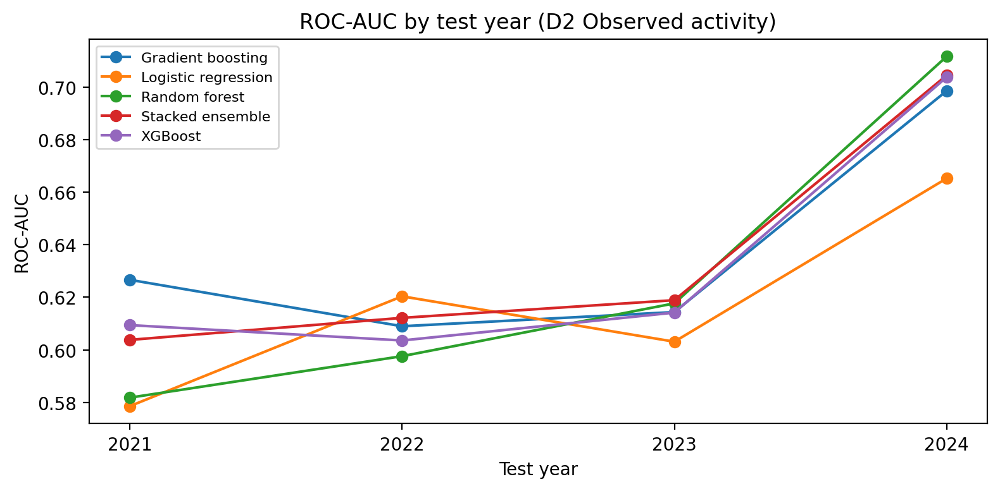
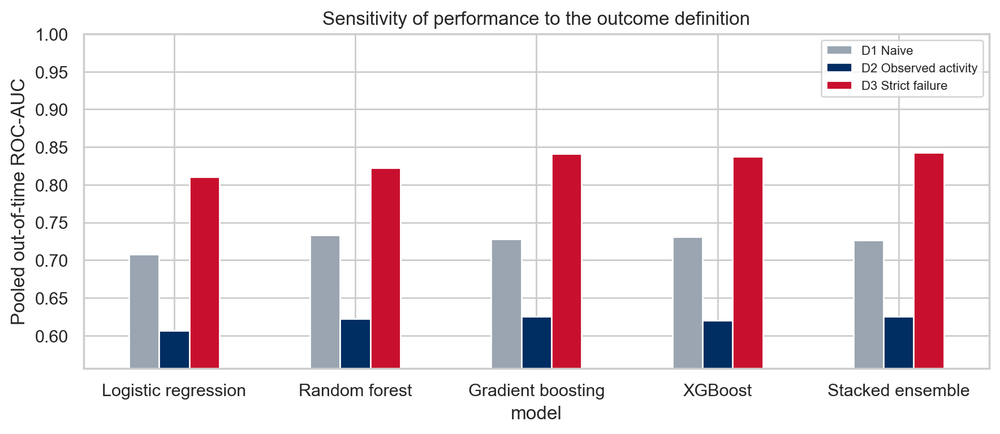
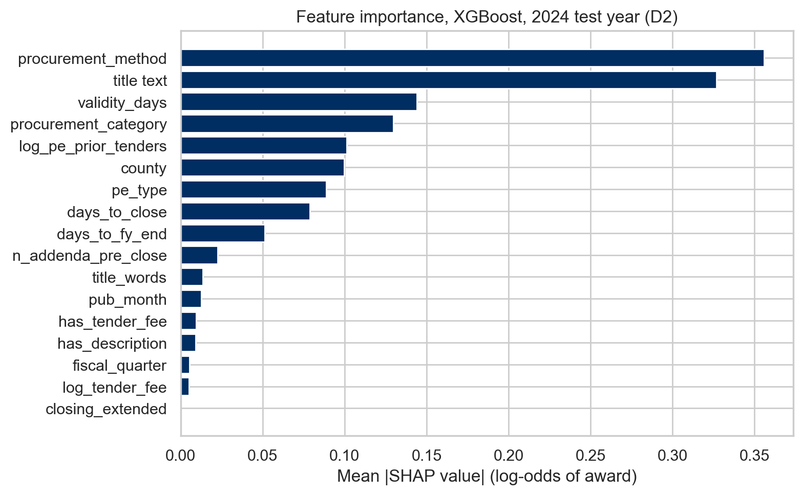
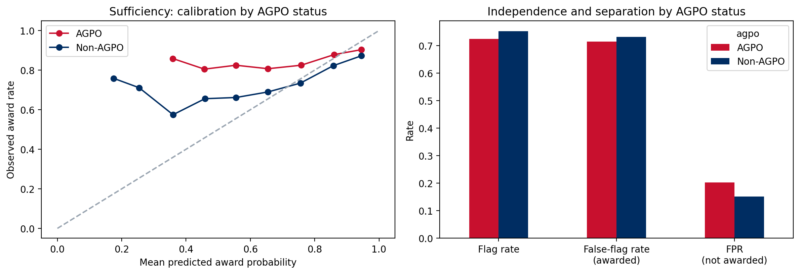
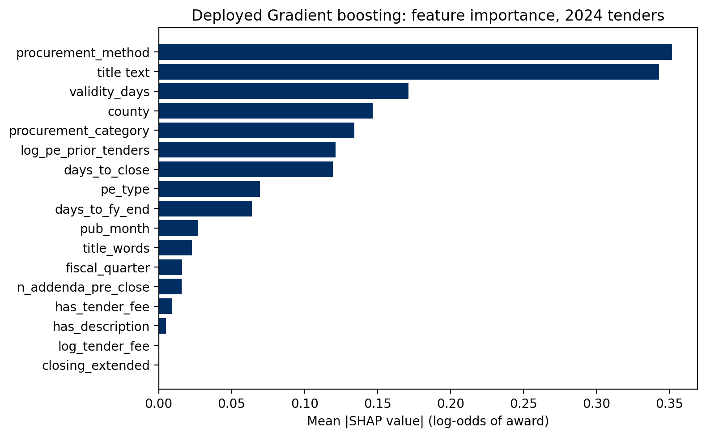

# Early-warning prediction of tender award failure in Kenyan public procurement

**Final report, DSA 8401 Applied Machine Learning capstone**

Emmanuel Bett (131611) · MSc Data Science and Analytics · Strathmore University · November 2026

Code, data pipeline, model artifacts, API and Docker configuration: <https://github.com/Emmanuelbett67/ppip-tender-award-risk>

---

## 1. Problem framing

Kenya's Public Procurement Information Portal (PPIP) records every tender advertised by a public entity. In the
export used here, 207,670 tenders were published, mostly between 2018 and 2024, and fewer than half have a recorded
contract award. A tender that fails wastes the administrative effort of advertising and evaluating it, leaves
budgeted money unspent in that fiscal year and delays the service it was meant to deliver. Today a failure becomes
visible only after the cycle closes, when nothing can be done about it.

**Decision problem.** Given what is known about a tender when it is published, estimate the probability that it will
reach contract award and express it as a risk score that a procuring entity can act on while the bidding window,
the procurement method or the specification can still be changed.

**Constraints that shape the problem.**

1. *Scoring point.* A predictor is admissible only if it exists by the closing date. Bid records are entered at or
   after bid opening, evaluation data after that, and contracts after award. The notebook dates every record type
   relative to closing (figure `du1_recording_timing`) to establish which fields are usable. The proposal's pilot
   feature set included the bidder count; it is excluded here because it is unknown at publication and almost
   determines the label (8.6% award rate with zero bidders, 86% otherwise).
2. *Label noise.* A tender without a contract record may have failed, may have stalled, or may simply never have had
   its award entered on the portal. This is a measurement problem, not a modelling nuisance, and it is handled in the
   data preparation (Section 3).
3. *Equity.* Thirty percent of procurement is reserved for AGPO enterprises (youth, women, persons with
   disabilities). A score that flags reserved tenders more often, or is worse calibrated for them, would shift
   scrutiny onto the groups the policy is meant to help. The score is therefore audited by AGPO status and county.

## 2. Data

Source: a MariaDB dump of the PPIP database (679 MB, snapshot 4 December 2024), with tenders linked to bidders,
contracts, suppliers, procuring entities, counties, addenda and terminations. The dump was loaded into MariaDB and
the needed tables exported as CSV; the notebook verifies cell by cell that the CSV extracts are faithful to the dump.

**Data-understanding findings that changed the design.**

- *Timing of records* (figure `du1`): addenda and submission methods exist before closing; bids, evaluation and
  awards do not.
- *Label maturity* (figure `du2`): the share of a year's tenders with a recorded outcome keeps rising for about a
  year after closing. Tenders published in late 2024 cannot have matured by the snapshot, so 2024 outcomes are
  partly censored; this is one reason 2024 metrics differ from earlier years.
- *Missingness is institutional* (figure `du3`, Section 3.2 of the notebook): the "no recorded activity" class
  clusters by procuring entity (η² = 0.26) far more than by procurement method (0.13), and 19.5% of the 559
  entities with at least 20 tenders show no activity on 90% or more of them. That pattern is reporting capacity, not failure.
- *Dirty dates.* About 50 tenders are dated before 2015 or after the snapshot; 1.1% have no publication date. The
  analysis window 2018–2024 covers over 99% of records.
- *No pre-award value.* Bid-security values and percentages are always zero and contract amounts exist only after
  award, so no tender-value feature is possible.

## 3. Method and justification

The work follows CRISP-DM; the executed notebook is the step-by-step record and the scripts in this repository are
the reproducible pipeline.

### 3.1 Analysis population and outcome taxonomy

| Step | Tenders |
|---|---|
| All tender records | 207,670 |
| Not soft-deleted | 204,506 |
| Published 2018–2024 | 203,122 |
| Flagged as published | 192,884 |
| Excluding EOI, prequalification, disposal (no contract by design) | **189,980** |

Each tender is assigned one class in priority order: **Awarded** (contract recorded, 48.4%), **Terminated**
(termination recorded, 2.5%), **Undetermined** (bids but no outcome, 6.2%), **No recorded activity** (42.9%).
Four checks validate the taxonomy: the tender-level terminated flag agrees with the termination table (99.999%),
only 19 tenders have both a contract and a termination, the termination reasons describe genuine failure
("all evaluated tenders non-responsive" 44%, "inadequate budgetary provision" 21%), and the η² analysis above.

Because the status of "no recorded activity" tenders is unknowable, three outcome definitions are evaluated and
one is pre-specified as primary:

| Definition | y = 1 | y = 0 | Excluded | n | award rate |
|---|---|---|---|---|---|
| D1 Naive | Awarded | everything else | – | 189,980 | 48.4% |
| **D2 Observed activity (primary)** | Awarded | Terminated + Undetermined | No activity | 108,527 | 84.8% |
| D3 Strict failure | Awarded | Terminated | Undetermined, No activity | 96,736 | 95.1% |

D2 is primary because it removes records whose status cannot be known while keeping enough negatives to model.

### 3.2 Features (information available by the closing date)

| Group | Features |
|---|---|
| Timing | days from publication to closing; publication month; fiscal quarter (July–June); days to fiscal-year end |
| Tender design | procurement method; category; validity period; tender fee (indicator and log amount) |
| Changes before closing | addenda issued before closing; closing date extended |
| Procuring entity | entity type; county; number of tenders the entity published before (experience, label-free) |
| Text | TF-IDF (1–2-grams, 20k vocabulary) of the title reduced to 50 dimensions by truncated SVD; description present |

AGPO status is **not** a predictor; it is held out for the audit. County is both a predictor and an audited
attribute, as the proposal specified. Preprocessing (group-median imputation within entity type with missingness
indicators, one-hot encoding with rare-level pooling, TF-IDF and SVD) is fitted inside every training window so no
information from the test year leaks in.

### 3.3 Models and why

| Family | Role | Reason |
|---|---|---|
| Logistic regression | interpretable baseline | the floor any complex model must beat; coefficients are auditable |
| Random forest | non-linear, low-tuning | handles mixed categorical and numeric data; robust to monotone transforms |
| Gradient boosting (histogram) | main candidate | strongest signals (method × category × window) interact non-linearly; boosting fits such interactions with regularisation |
| XGBoost | second boosting implementation | industry standard; exact TreeSHAP attributions built in |
| Stacked ensemble | tests whether combining helps | logistic meta-learner on out-of-fold probabilities of the four base models |

Hyperparameters are chosen once by randomised search (ROC-AUC) fitting on 2018–2019 and validating on 2020, which
precedes every test year. Each model's classification threshold is the macro-F1 maximiser on the same 2020 year.
Tuning and thresholds therefore never see test data.

**Techniques considered and not used.**

- *Deep learning (MLP, transformer on titles).* The data are tabular with one short text field. Boosted trees are
  the established best choice for this regime, and the ceiling here is set by label noise rather than model
  capacity (the five families differ by ≤ 0.02 AUC). A transformer on titles would add cost and opacity without a
  mechanism for gain.
- *LLM fine-tuning / RAG.* No generative task exists; the output is a calibrated probability.
- *Unsupervised anomaly detection.* The target is observed, so supervised learning is strictly more informative.
  Clustering was used only diagnostically (η² by entity).
- *Cost-sensitive reweighting.* Instead of reweighting, thresholds are tuned for macro-F1 and the operational
  output is a risk band from score quantiles, which lets the user set the review budget.
- *Random cross-validation.* Rejected as the evaluation design because it leaks the future (quantified below).

### 3.4 Evaluation design

Forward-chaining temporal validation: for each test year Y in 2021–2024, train on 2018…Y−1 and test on Y;
pool the out-of-time predictions. Metrics: ROC-AUC, precision, recall, F1 for both classes, balanced accuracy;
95% bootstrap confidence intervals (1,000 resamples); DeLong's test for correlated ROC curves and McNemar's test
for paired classification differences against the best model; sensitivity of every result to the outcome
definition. Fairness: independence (flag rate), separation (false-flag rate among awarded tenders, FPR), and
sufficiency (calibration, expected calibration error, likelihood-ratio test for group terms) by AGPO status, with
bootstrap CIs; county disparities as the range of rates across 27 counties with ≥ 300 test tenders.

### 3.5 Serving

The selected model is refitted on all 2018–2024 tenders under D2 and serialized together with its fitted
preprocessor, threshold and risk-band cut-offs. A FastAPI service in a Docker container accepts the
publication-time fields, computes the features with the same code as the pipeline, and returns the award
probability, a Low/Medium/High band (training-risk quantiles 50/80) and the three features with the largest
TreeSHAP contributions. Fairness summaries by AGPO status and county are produced by the evaluation script
and are intended to be re-run as new outcomes mature.

## 4. Results

All numbers in 4.1, 4.3, 4.5 and 4.6 are the outputs of `scripts/evaluate.py` and `scripts/train.py` committed under
`reports/metrics/`. The random-split comparison (4.2) and the SHAP sensitivity analysis (4.4) are computed in the
research notebook; the scripted run reproduces the notebook's metrics to within 0.002 AUC.

### 4.1 Performance under temporal validation (primary definition D2)

| Model | Accuracy | Precision | Recall | F1 (award) | F1 (non-award) | Bal. acc. | ROC-AUC [95% CI] |
|---|---|---|---|---|---|---|---|
| Logistic regression | 0.606 | 0.868 | 0.621 | 0.724 | 0.314 | 0.577 | 0.607 [0.602, 0.611] |
| Random forest | 0.535 | 0.879 | 0.511 | 0.646 | 0.323 | 0.583 | 0.622 [0.617, 0.627] |
| **Gradient boosting** | 0.364 | 0.893 | 0.267 | 0.411 | 0.309 | 0.555 | **0.626 [0.621, 0.631]** |
| XGBoost | 0.340 | 0.889 | 0.235 | 0.372 | 0.305 | 0.546 | 0.620 [0.616, 0.625] |
| Stacked ensemble | 0.338 | 0.889 | 0.233 | 0.369 | 0.304 | 0.545 | 0.625 [0.620, 0.630] |

Gradient boosting has the highest pooled ROC-AUC and is selected. DeLong tests: it beats logistic regression
(Δ = 0.019, p < 10⁻²⁰) and XGBoost (Δ = 0.005, p = 7 × 10⁻⁶), is borderline against random forest
(Δ = 0.003, p = 0.050) and indistinguishable from the stack (Δ = 0.0004, p = 0.67). The stack adds nothing, which is itself informative:
the families are extracting the same signal.

*Interpretation.* The accuracies look poor because the threshold maximises macro-F1 on a task where non-award is
the 15% minority: the models flag most tenders to catch most failures. The operationally relevant numbers are
ranking quality (AUC) and the precision of the high-risk band, not accuracy. An AUC of 0.63 means the score is a
real but modest signal: a randomly chosen failing tender scores below a randomly chosen awarded one 63% of the
time.

AUC rises from 0.61–0.63 in 2021–2023 to 0.70 in 2024 for the tree models. Part of that is censoring: late-2024
tenders had not matured by the snapshot, so the 2024 negatives are enriched with clear-cut, early failures.

### 4.2 Why temporal validation matters

The same XGBoost configuration evaluated with a random stratified 80/20 split over 2018–2024 gives
**AUC 0.785**, against a forward-chaining mean of **0.633** (range 0.60–0.70): an optimism of **+0.15**. The proposal's pilot figure of
0.74 was of this kind. A random split lets the model learn entity- and period-specific patterns that it cannot
know for future tenders.

### 4.3 Sensitivity to the outcome definition

| Definition | Gradient boosting AUC |
|---|---|
| D1 Naive | 0.728 |
| D2 Observed activity | 0.626 |
| D3 Strict failure | 0.842 |

Three different "truths" give three different headline numbers. D1 is inflated because non-reporting entities are
predictable from `pe_type` and entity experience, so the model is partly predicting who fills in the portal. D3 is
easiest because documented terminations are a small, distinctive set. D2 is the honest middle. The *drivers*,
however, are stable: Spearman correlation of feature-importance rankings is 0.89 (D1 vs D2) and 0.87 (D2 vs D3),
and procurement method is the top feature under every definition.

### 4.4 What drives award

Under D2, mean |SHAP| ranks: procurement method (0.36), title text (0.33), validity period (0.14), procurement
category (0.13), entity experience (0.10), county (0.10), entity type (0.09), days to close (0.08). Dependence
plots (figure 09) show longer validity periods and more experienced entities raising award probability, and very
short bidding windows lowering it. Addenda and extensions matter little once the window is accounted for.

### 4.5 Fairness audit

| Criterion (AGPO − Non-AGPO) | Difference | 95% CI | Reading |
|---|---|---|---|
| Independence: flag rate | −0.029 | [−0.035, −0.023] | reserved tenders flagged slightly *less* |
| Separation: false-flag rate among awarded | −0.017 | [−0.023, −0.010] | fewer awarded AGPO tenders wrongly flagged |
| Separation: FPR among not awarded | +0.051 | [0.035, 0.066] | more failing AGPO tenders missed |
| Sufficiency: ECE | −0.005 | [−0.010, 0.001] | calibration equal |

AGPO tenders have a higher base award rate (88% vs 82%), so independence and separation cannot both hold; the
score errs on the side of *under*-flagging reserved tenders, and its probabilities mean the same thing for both
groups (the likelihood-ratio test for AGPO terms is significant, p ≈ 10⁻¹¹⁰, driven by the 86,000-tender sample;
the ECE difference is practically zero). The harm the proposal worried about, disproportionate scrutiny of
reserved tenders, is not present.

County is a different story (figure 11): across 27 counties with ≥ 300 test tenders the flag rate ranges from
0.26 to 0.99 and ECE from 0.01 to 0.23. County is a predictor, and some counties genuinely fail more, but
disparities of this size also reflect reporting differences between county governments. Any deployment should
report county-level flag rates and should not use the score to compare counties with each other.

### 4.6 Deployed service

`scripts/train.py` refits gradient boosting on 108,527 tenders (D2, 2018–2024) and writes
`models/award_risk_v2/award_risk_bundle.joblib` (threshold 0.94; High band ≥ 0.21 failure risk, Medium ≥ 0.11).
The API (`api/main.py`) validates the request schema, rejects post-closing fields by construction, and returns the
probability, band and three SHAP reasons in about 120 ms per warm call. The deployed model's own TreeSHAP
importance on 2024 tenders (figure below) reproduces the ranking found in the evaluation: procurement method
(0.35), title text (0.34), validity period (0.17), county (0.15), category (0.13), entity experience (0.12),
days to close (0.12).

The Docker image builds from the pinned
dependency set and is exercised in CI with a live `/predict` call.

## 5. Limitations

1. **The signal is modest.** AUC 0.63 under the honest definition. The score is a triage aid for choosing which
   tenders to review, not a predictor to act on alone. The ceiling is label quality: 43% of tenders have no
   outcome recorded at all, and the primary definition can only drop them, not recover them.
2. **The label is still contaminated.** "Undetermined" tenders (bids but no outcome) include stalled procurements
   and unpublished awards. Linking to payment or audit data would separate them; the portal cannot.
3. **Right-censoring.** Outcomes keep arriving for about a year after closing. The last test year is partly
   immature, which inflates 2024 metrics for early-failing tenders and will do the same for any live monitoring
   until outcomes mature.
4. **No tender value.** The strongest feature in the procurement literature is unavailable before award in this
   export.
5. **County disparities.** The score is not equitable across counties by any of the three criteria. Because county
   missingness is institutional, this is as much a data-quality finding as a model finding, but it limits use.
6. **Distribution shift.** Procurement rules, the portal's workflow and reporting compliance changed over
   2018–2024 (the 2020 validation year is also the COVID-19 year). Forward-chaining measures the shift; it does
   not remove it. Monthly drift checks and retraining, as sketched in the proposal, are necessary, not optional.
7. **Explanations are attributions, not causes.** SHAP reasons say what moved the score, not what would change the
   outcome. "Procurement method lowers award probability" is not advice to change the method.
8. **Compute.** The full evaluation (5 families × 3 definitions × 4 years, plus 1,000 bootstrap resamples) takes
   about 40 minutes; the pipeline exposes a `--fast` mode for review but the committed metrics come from the full
   run.

## 6. Real-world relevance and next steps

For the Public Procurement Regulatory Authority the immediate value is less the score than the measurement it
forced: 43% of advertised tenders have no outcome on the portal, concentrated in identifiable entities. Fixing
that reporting would improve the score more than any modelling change. With the score as it stands, a procuring
entity can rank its draft tenders, see which design choices raise risk, and lengthen windows or revisit methods
before publication. Next steps: join predictions to matured outcomes monthly for drift and AGPO-gap monitoring;
add fields that exist at publication but were not in this export (estimated value, submission method); and
calibrate per county once county reporting is comparable.

## References

- DeLong, E. R., DeLong, D. M., & Clarke-Pearson, D. L. (1988). Comparing the areas under two or more correlated ROC curves. *Biometrics*, 44(3), 837–845.
- Sun, X., & Xu, W. (2014). Fast implementation of DeLong's algorithm. *IEEE Signal Processing Letters*, 21(11), 1389–1393.
- Lundberg, S. M., Erion, G., et al. (2020). From local explanations to global understanding with explainable AI for trees. *Nature Machine Intelligence*, 2, 56–67.
- Barocas, S., Hardt, M., & Narayanan, A. (2023). *Fairness and Machine Learning*. MIT Press. (Independence, separation, sufficiency.)
- Public Procurement and Asset Disposal Act, 2015 (Kenya); Public Procurement Regulatory Authority, PPIP (tenders.go.ke).
- Fazekas, M., & Kocsis, G. (2020). Uncovering high-level corruption: cross-national objective corruption risk indicators using public procurement data. *British Journal of Political Science*, 50(1), 155–164.
